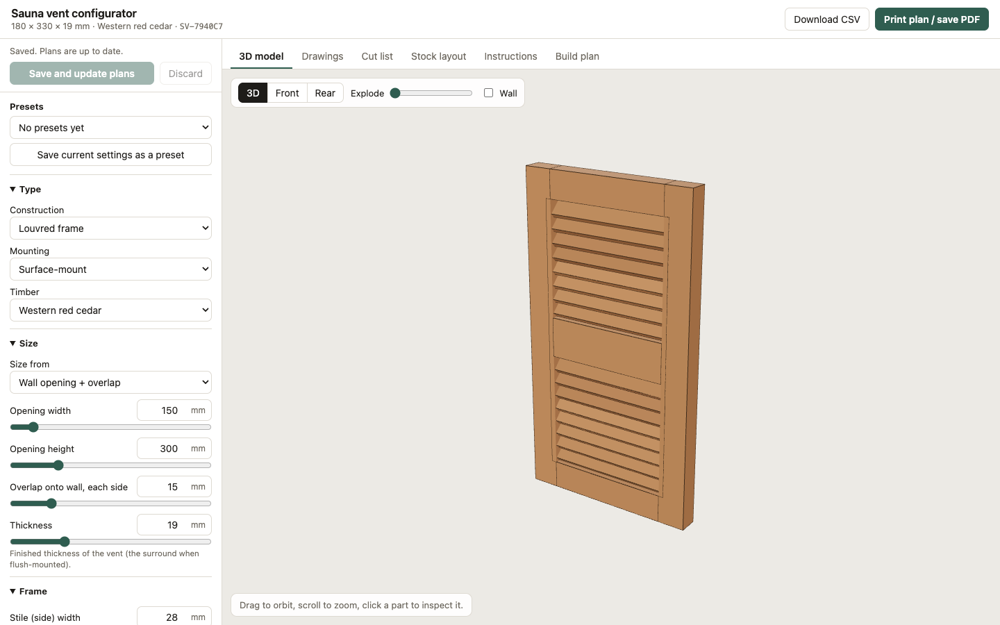
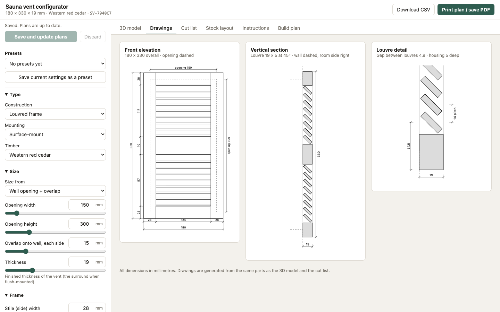
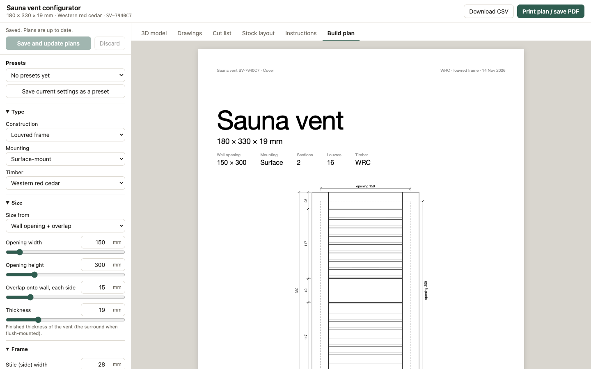
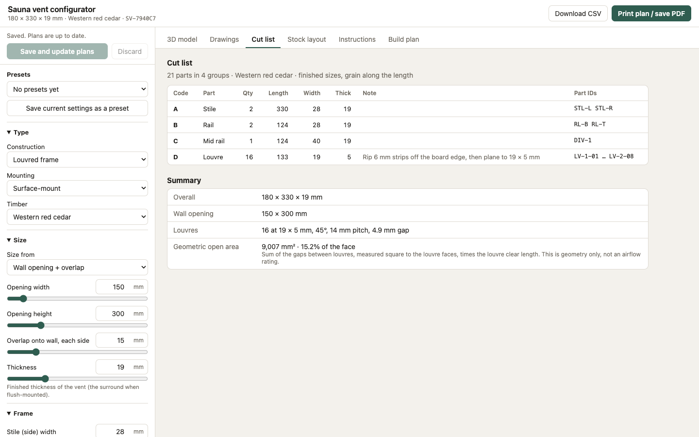
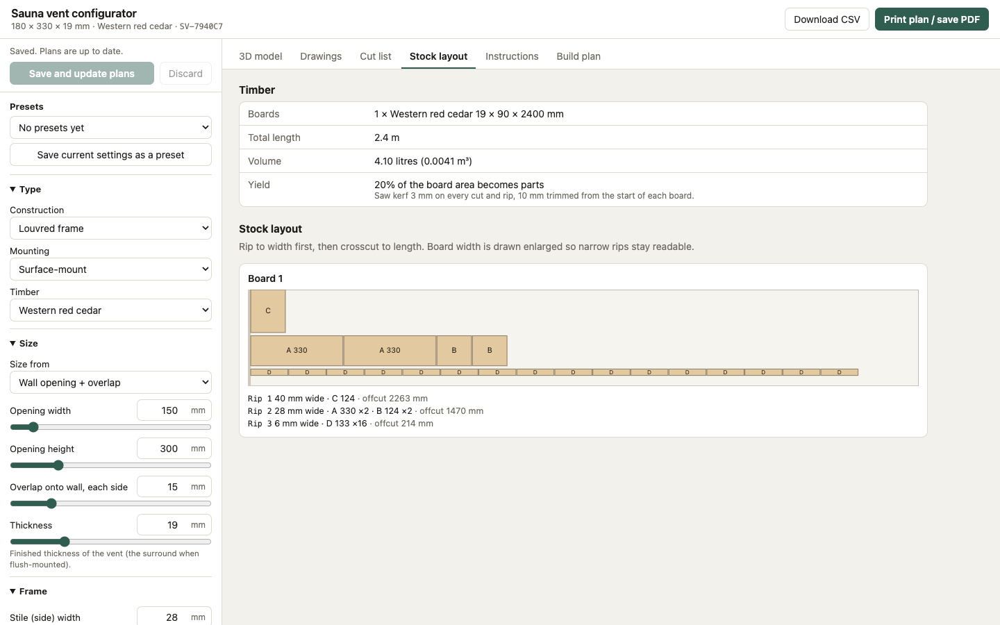

# Sauna vent configurator

A browser-based parametric configurator for wooden sauna vents and louvred grilles. Set the dimensions, preview the vent in 3D, then save to generate drawings, a cut list, a stock layout, instructions and a printable build plan, all from one calculation engine.

**[Try the live example](https://ttiimmaacc.github.io/Vent-configurator/)**



| Drawings | Build plan |
|---|---|
|  |  |
| **Cut list** | **Stock layout** |
|  |  |

## Run it

Needs Node 18 or newer.

```bash
npm install
npm run dev
```

Then open http://localhost:5183.

```bash
npm test          # engine and geometry tests
npm run build     # type-check and production build into dist/
```

Every push to `main` runs the tests and publishes the build to GitHub Pages (`.github/workflows/deploy.yml`).

## What it models

| | Options |
|---|---|
| Construction | Louvred frame (stiles, rails, angled louvres in blind housings) · Routed slotted panel |
| Mounting | Surface-mount over the opening · Flush, as a drop-in insert in a mitred surround |
| Sections | 1 to 6, stacked with mid rails or side by side with mullions |
| Frame joints | Butt with dowels · Stub tenon · Mitred corners |
| Sizing | From wall opening + overlap, or from overall size |
| Louvres | Thickness, angle, width (auto or manual), quantity (auto from target spacing, or manual) |
| Stock | Board thickness, width, length, saw kerf, end trim |

Fixed grilles only. Adjustable (closable) mechanisms are not modelled yet.

## Using it

- **Edit, then save.** The controls edit a draft and the 3D view previews it live. Press **Save and update plans** to regenerate the drawings, cut list, stock layout, instructions, build plan and CSVs.
- **Issues point at their inputs.** An error or warning highlights the inputs that cause it. Most errors offer a one-click fix.
- **Presets.** Save the current settings under a name and load them later. Presets and the saved design are kept in the browser.
- **View in your space.** On an iPhone or iPad in Safari, this shows the vent at real size through the camera, using AR Quick Look. Either set its height above the floor and slide it to the wall (quickest), or stick it straight to a wall. Red alignment marks help line it up. It shows the design as it stands when you tap; other devices download a USDZ file instead.
- **Linkable tabs.** Add `#drawings`, `#cut`, `#stock`, `#steps` or `#plan` to the address to open a tab directly.

## Outputs

- **3D model**: orbit and zoom, front and rear views, exploded view, click a part to inspect it, optional wall.
- **Drawings**: dimensioned front elevation, vertical section and louvre or slot detail.
- **Cut list**: grouped by part with stable part IDs.
- **Stock layout**: rip-then-crosscut layout per board, with kerf and end trim.
- **Instructions**: machining and assembly steps, hardware, housing or slot stations.
- **Build plan**: five A4 pages in the Build Plan Style Spec. "Print plan / save PDF" opens the browser print dialog; choose Save as PDF, A4, no margins.
- **CSV**: cut list, all parts, stock layout, materials.

## How it is built

```
src/engine/      Pure TypeScript, no UI. Millimetres throughout.
  params.ts        Defaults, input ranges, field definitions for the controls
  design.ts        computeDesign(params): validation, geometry, parts. The single source of truth
  cutlist.ts       Groups parts into lettered rows
  stock.ts         Two-stage stock layout with kerf
  instructions.ts  Steps generated from the computed design
  drawings.ts      2D drawings projected from the same part solids
  csv.ts           CSV exports
  engine.test.ts   Invariant tests over several hundred configurations, including every fix
src/ui/          React, React Three Fiber
  ar.ts            USDZ export for AR Quick Look, real size, anchored to a wall
```

Every output reads the one `Design` object returned by `computeDesign`. The 3D meshes, the drawings and the section view are all generated from the same part solids, so they cannot disagree.

Axes: X is width, Y is height, Z is depth. z = 0 is the wall face and +Z faces the room.

### Part identifiers

`STL-L` `STL-R` stiles · `RL-T` `RL-B` rails · `DIV-n` mid rails or mullions · `LV-s-nn` louvre nn in section s · `PNL` slotted panel · `SUR-T` `SUR-B` `SUR-L` `SUR-R` surround.

Each design also gets an ID such as `SV-7940C7`, a hash of its inputs. The same inputs always give the same ID, and it appears on every plan page and in every CSV.

### Construction rules

Defined once in `RULES` in `design.ts` and listed in the Instructions tab:

- Louvres are cut 0.5 mm short of the housing bottom at each end.
- At least 6 mm of timber is kept beside every housing, rebate and ledge.
- Neighbouring louvres keep at least 1 mm of gap, measured square to their faces.
- A flush insert leaves a ledge at least 3 mm thick.
- Louvre strips are ripped 1 mm over thickness for planing.
- Glued-up panel blanks get 20 mm extra length and 10 mm extra width.
- Two dowels per joint when the rail is at least four dowel diameters wide, otherwise one.

Validation rules R01 to R13 reject or flag designs that break these. Each issue names the inputs behind it and, where there is one unambiguous change, a fix. An invalid design never produces parts and cannot be saved.

## Assumptions to check before cutting

These came from reading photographs, not from measured drawings:

- Default proportions (5 mm louvres at 45°, 14 mm spacing, 28 mm stiles, 19 mm thick) are estimates. Every one is an input.
- Louvre housings are modelled as blind, angled and centred in the thickness.
- Slots are straight through-cuts with the grain running along them.
- The front-edge round-over is listed in the steps but not drawn in 3D.
- "Open area" is geometry only. No airflow or ventilation performance is claimed or calculated.
- Fixings, glue type and finish are not specified.
- The plan pages fall back to Helvetica or Arial when Helvetica Now is not installed.
